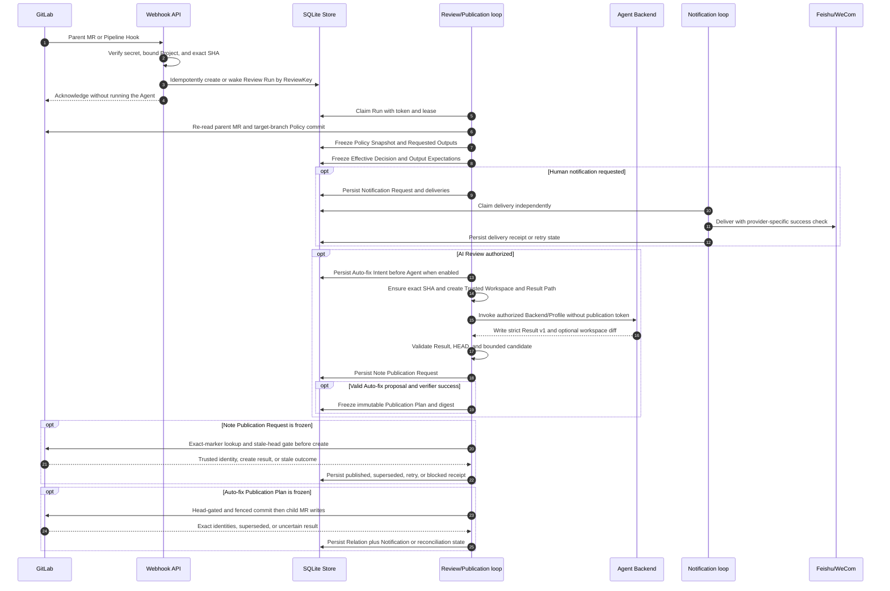

# Event and lifecycle specification

## Parent Review

下图说明一次父 MR Review 的持久化顺序与权限边界。Agent 执行后的两个分支
保持独立：Auto-fix 提议被拒绝不会压制有效 Note，且本地 Publication Request
或 Plan 持久化前不会尝试对应外部副作用。



异常 Auto-fix 发布与恢复继续遵循
[05-integrations.md](./05-integrations.md#auto-fix-publication) 中的精确写阶段状态机。

1. GitLab Merge Request Hook 通过 webhook secret 和单 Project 绑定校验。
2. 只接受父 MR IID 与 `last_commit.id|last_commit_id` 的精确 head SHA。Draft
   或非法事件不入队。
3. Store 以 `(project_id, parent_mr_iid, sha)` 幂等创建 Review Run。
4. Pipeline Gate 启用时，Pipeline Hook 只唤醒已有 pending Run，不创建新类型的 Run。
5. Review 循环以 claim token/lease 领取 Run，再次校验 MR，并从目标分支精确
   commit 读取 Policy v4；Policy Snapshot 与 Requested Outputs 每个 Run 只冻结一次。
6. MR eligibility 和 Operator 授权解析后，Effective Run Decision 与逐 channel/Note
   Output Expectations 在任何用户可见副作用前原子冻结。
7. Human 通知请求按 Operator-owned channel 持久化；Notification 循环独立投递。
8. AI 路径确保 SHA 可用，创建 Trusted Workspace 和受控 Result Path，调用
   Operator 授权的 Backend/Profile。
9. Agent 成功后，ReviewFlow 分别验证 Note 结果和可选 Auto-fix
   提议；两种效果互不回滚。
10. 首次发布前如 head 已变更，旧 SHA 的未发布效果终止为
   `superseded`，新 SHA 使用新 ReviewKey。
11. Worktree cleanup 是独立资源任务，失败不会重跑 Agent。
12. Worker lease 在 Note Request 已冻结后过期时，重试直接完成并发布该持久化
    Note，不再次调用非确定性 Agent；若 Auto-fix Plan 尚未持久化，则对应 Intent
    和 receipt fail closed 为 `blocked`，不从遗留 worktree 推断候选。

## Program-owned Note

ReviewFlow 使用以下独立 marker 持久化 Note Publication Request：

```text
<!-- reviewflow:v1;project=<project-id>;mr=<iid>;sha=<sha>;effect=note -->
```

调用结果不确定时，程序只信任当前 Review Bot 在精确 Project/MR
中发布的一个精确 marker。零个可重试，多个或内容冲突进入
`blocked`。已确认 Note 被用户删除后记录为 removed，不自动重建。

## Program-owned Auto-fix

1. Effective Decision 允许 Auto-fix 时，ReviewFlow 在 Agent 前创建一个 active
   Intent generation 和不可变 nonce。普通重试和 blocked Plan re-arm 都复用同一
   个不可变 Plan/generation/nonce；新候选内容才创建新 Intent。
2. 只有 Agent Result 显式包含 `autofix_proposal` 且 workspace 有非空合法 diff
   时才继续。提议/diff 不一致是 Agent contract mismatch，但有效 Note 仍可发布。
3. Diff Envelope 只允许有界、常规、非二进制文本文件的新增、修改、
   删除和可执行位变化；拒绝 symlink、gitlink/submodule、路径逃逸和超限。
4. Operator verification 通过后，程序冻结唯一 Publication Plan 与
   `plan_sha256`，同时产生 Auto-fix Output Expectation。
5. Publisher 以 `start_sha=ReviewKey.sha`、`force=false` 和 canonical actions 创建
   branch commit，再创建父 MR source branch 为 target 的子 MR。
6. 安全默认是 Draft 且 commit 跳过自动 CI。Operator 可显式配置
   `draft/automatic` 或 `ready/automatic`，不允许 `ready/manual`。
7. GitLab 返回子 MR 身份后，Store 持久化 Relation 和幂等 Notification
   Request，只通知父 MR 创建者。

```text
<!-- reviewflow:v1;project=<project-id>;mr=<iid>;sha=<sha>;effect=autofix;intent=<nonce>;plan_sha256=<digest> -->
autofix/MR-<iid>/sha-<sha>/intent-<nonce>
```

## Reconciliation and recovery

- Reconciler 只处理不确定 provider 结果、进程崩溃、已知 Relation 状态和
  Operator 显式恢复。确认缺失时可恢复缺失步骤；精确匹配可继续；
  冲突或多候选进入 `blocked`。
- 子 MR Webhook 只能更新或唤醒已有 Intent/Relation，不创建 Review Run，
  不在没有本地授权时建立 Relation。
- Relation 建立后，title、description 和 Draft/Ready 变化不改变身份。
  source/target/tree 漂移只标记状态，程序不 force-push 或覆盖。
- Store 丢失后，本地 Operator CLI 必须校验唯一 Bot MR、ReviewKey、nonce、
  plan digest、branch、target、marker 和 remote actions，并记录理由与审计主体。
  恢复不自动补发通知；补发需要独立审计命令。

Auto-fix MR 合并后只抑制其实际产生的父 MR SHA；之后的用户 SHA
按普通 ReviewKey 处理。
