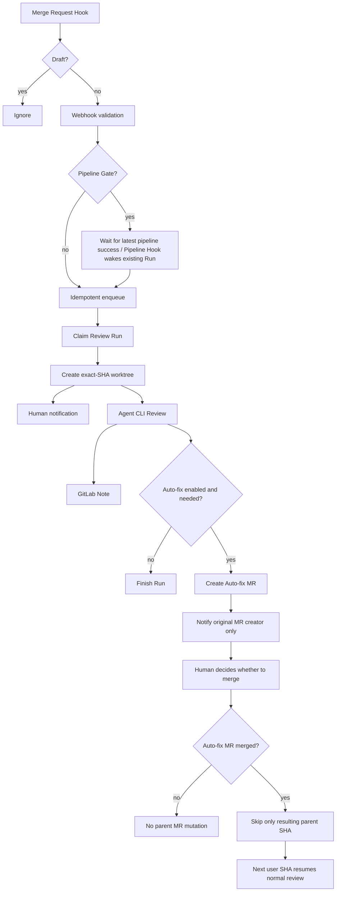

# Event and lifecycle specification

## Normal Review Run

1. GitLab 发送 Merge Request Hook。
2. Webhook 验证必填 token，要求事件 Project ID 等于进程绑定的 Project，并读取 MR IID、action、draft 状态和精确 head SHA；普通评审只接受 `last_commit.id` 或 `last_commit_id`，不把 `merge_commit_sha` 当作普通 head SHA。
3. Draft MR 不创建运行；如果 Webhook 与 Worker 获取 MR 之间发生状态竞态，Worker 会重新排队而不发送通知或启动 Agent。
4. 若 Project 启用 Pipeline Gate，Worker 将对应 Run 延后到下一次可检查时间；成功 Pipeline Hook 只唤醒已有 pending Run，不创建独立 Pipeline Run；等待中的 Run 不阻塞后续已就绪 Run。
5. Store 以 `(project_id, mr_iid, sha, kind=normal)` 去重并创建 `pending` Review Run。
6. Worker 以租约 claim 一个可执行的 pending Run；AI 路径先执行 `ensure_sha`，在仓库锁内限时 fetch 并再次校验 exact commit，再创建该 SHA 的独立 worktree；租约过期的 Run 最多自动恢复三次。
7. Worker 按 Policy 将 Human 通知写入按渠道拆分的 outbox，并触发 Human Review 和/或 Agent Review；通知投递失败不改变 Review Run 状态，两条路径互不依赖。
8. Agent 直接提交 Note；如果 Policy 允许并且 Agent 判断需要修复，则创建 Auto-fix MR。
9. Worker 记录成功、失败或取消。Worktree 清理有独立记录和重试，不因清理失败重新执行 Agent。



## Auto-fix identity and loop rule

The service registers an Auto-fix intent before invoking the Agent. The title prefix and branch are required output conventions, but are not trusted identities by themselves. The Agent must include the following Run/SHA marker in the child MR description:

```text
[ReviewFlow Auto-Fix] <original title>
ReviewFlow-Auto-Fix-Run-ID:<run-id> SHA:<parent-sha>
```

The Store must persist the intent and, once the child MR exists, the relation:

```text
parent_project_id
parent_mr_iid
parent_sha
run_id
source_branch
target_branch
auto_fix_project_id
auto_fix_mr_iid
merged_sha
```

When GitLab reports the parent MR head changed because the related Auto-fix MR merged, the service suppresses only that exact `merged_sha`. A later SHA without a related auto-fix merge is a normal trigger.

## Auto-fix MR lifecycle

- One Auto-fix MR is created per Review Run that produces an auto-fix proposal.
- Existing Auto-fix MRs are not overwritten by later Runs.
- The Auto-fix MR runs ordinary CI.
- The Auto-fix MR does not trigger AI Review or another auto-fix.
- Only the original parent MR creator receives the human review notification.

An MR with a user-controlled Auto-fix-looking title or branch but no matching server intent and description marker is processed as a normal MR, not as Auto-fix. An intent that reaches a terminal Run without a reconciled child MR is marked `abandoned` and cannot be reused.
