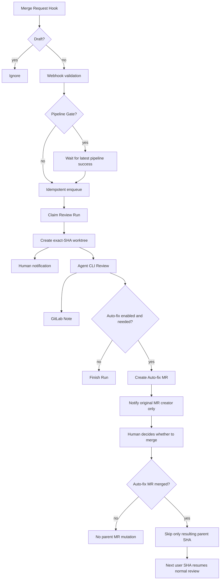

# Event and lifecycle specification

## Normal Review Run

1. GitLab 发送 Merge Request Hook。
2. Webhook 验证 token，读取 Project、MR IID、action、draft 状态和 head SHA。
3. Draft MR 被忽略；不满足触发条件的事件只记录，不创建运行。
4. 若 Project 启用 Pipeline Gate，Worker 等待对应 SHA 的最新 Pipeline 成功。
5. Store 以 `(project_id, mr_iid, sha, kind=normal)` 去重并创建 `pending` Review Run。
6. Worker claim 一个 pending Run，创建该 SHA 的独立 worktree。
7. Worker 按 Policy 触发 Human Review 和/或 Agent Review。两条路径互不依赖。
8. Agent 直接提交 Note；如果 Policy 允许并且 Agent 判断需要修复，则创建 Auto-fix MR。
9. Worker 记录成功、失败或取消，清理 worktree。



## Auto-fix loop rule

The title prefix identifies the Auto-fix MR itself:

```text
[ReviewFlow Auto-Fix] <original title>
```

The title is not sufficient after the Auto-fix MR is merged into the parent source branch. Therefore the Store must persist:

```text
parent_project_id
parent_mr_iid
parent_sha
run_id
auto_fix_project_id
auto_fix_mr_iid
merged_sha
```

When GitLab reports the parent MR head changed because the related Auto-fix MR merged, the service suppresses only that exact `merged_sha`. A later SHA without a related auto-fix merge is a normal trigger.

## Auto-fix MR lifecycle

- One Auto-fix MR is created per Review Run that produces an auto-fix proposal.
- Existing Auto-fix MRs are not overwritten by later Runs.
- The Auto-fix MR runs ordinary CI.
- The Auto-fix MR does not trigger AI Review or another auto-fix.
- Only the original parent MR creator receives the human review notification.
