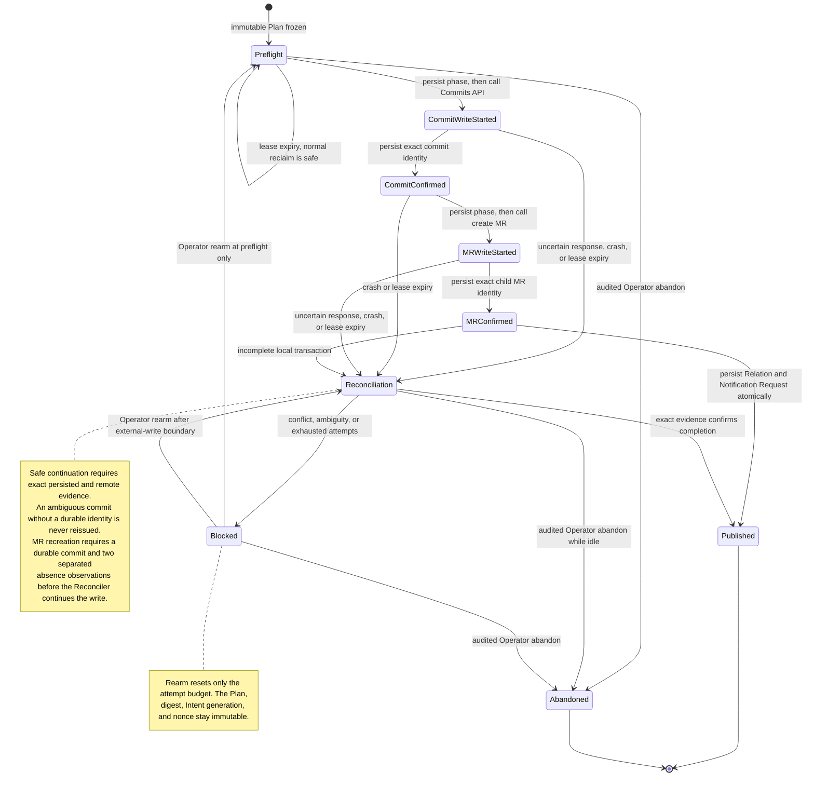

# Integration specification

## GitLab ingress

The API accepts GitLab Merge Request Hooks at `POST /webhooks/gitlab` only after `GITLAB_WEBHOOK_SECRET` and `REVIEW_AGENT_FLOW_PROJECT_ID` are configured. It checks `X-Gitlab-Token` on every request; a wrong token returns `401`, and a payload from another Project returns `403` without enqueueing work. The reference deployment binds one Project per process.

Parent review intake uses only `object_attributes.last_commit.id` or `object_attributes.last_commit_id`. `merge_commit_sha` is never a parent review fallback. Every ReviewKey SHA must be a 40- or 64-character hexadecimal SHA; invalid or incomplete identity is rejected.

A Pipeline Hook only wakes an existing deferred Review Run for the same ReviewKey. An Auto-fix child MR Hook only updates or wakes an existing local Intent/Relation or reconciliation item. It never creates a Review Run and never establishes a relation without local authority.

## GitLab adapter and Note publication

The adapter uses `python-gitlab` behind narrow domain interfaces for:

- parent MR, Pipeline and branch observation;
- paginated trusted Review Bot Note lookup and Note creation;
- repository commit creation through the GitLab Commits API;
- Auto-fix MR creation and exact source/target/state observation.

Before publishing any effect, ReviewFlow confirms the parent MR still has the ReviewKey SHA. A stale ReviewKey becomes `superseded`; no old Note or Auto-fix is published.

ReviewFlow creates a Note containing exactly one canonical marker:

```text
<!-- reviewflow:v1;project=<project-id>;mr=<iid>;sha=<sha>;effect=note -->
```

Lookup is scoped to the Project and parent MR, paginates all Notes and trusts only the configured Review Bot author's exact marker. Zero matches permits creation; one valid match adopts the external identity; duplicates or malformed matches fail closed for reconciliation. A Note confirmed deleted by the user is not recreated.

## Auto-fix publication

AutoFixPublisher consumes a persisted immutable Publication Plan. It creates the source branch and commit atomically with the GitLab Commits API using the Plan's ordered actions, `start_sha=ReviewKey.sha` and `force=false`, then creates a same-Project child MR targeting the parent MR's original source branch. Fork-source Auto-fix is unsupported in v0.1.

The Program owns branch, commit, title, target, creation readiness, CI trigger and description marker:

```text
autofix/MR-<iid>/sha-<sha>/intent-<nonce>
<!-- reviewflow:v1;project=<project-id>;mr=<iid>;sha=<sha>;effect=autofix;intent=<nonce>;plan_sha256=<digest> -->
```

For `initial_readiness=draft`, the frozen creation title begins with GitLab's canonical `Draft: ` prefix; `ready` omits it. Readiness is not sent as an undocumented create-MR field.

The digest input is the canonical UTF-8 JSON Plan payload with sorted keys and no insignificant whitespace. It contains every publication input and a marker template, but excludes the derived `plan_sha256` value and final rendered marker. ReviewFlow hashes that payload, renders the marker from the digest, and freezes the payload, digest and final marker together. This avoids self-reference while binding every independent publication choice. Retry uses the same frozen Plan and Intent nonce.

After GitLab returns the child identity, ReviewFlow persists the Auto-fix Relation and its idempotent Notification Request in one SQLite transaction. A publishable Relation cannot be committed without that request; reconciliation repairs an older incomplete transaction state before treating publication as complete.

Presentation changes after creation, including title, description text around the marker and Draft/Ready state, do not invalidate a Relation. Source/target/tree drift is observed as divergence; ReviewFlow never force-updates user changes. A Relation records opened, closed and merged states, including the merge SHA used to suppress only that exact parent SHA.

Before each GitLab write, the Publisher durably moves the Plan from `preflight` to `commit_write_started`, or from `commit_confirmed` to `mr_write_started`. Successful responses persist `commit_confirmed` and `mr_confirmed` with their exact identities before the next step. A process lease that expires in `preflight` is safe to reclaim normally; every later unfinished phase enters reconciliation.

The Reconciler searches only when an external result is uncertain, a process may have crashed, relation state may have changed or an Operator requested recovery. The normal path does not search for Agent-created artifacts because the Agent cannot create them. After an ambiguous create-MR result it requires two unique zero-candidate observations separated by at least five seconds, independent of polling/retry configuration, before clearing the uncertain boundary and recreating the MR. Recreation is allowed only when the branch commit identity is already durable and the parent still matches the frozen exact SHA. A discovered or persisted-IID child is re-fetched and its exact source head must equal that durable commit before Relation persistence. An ambiguous commit without a durable commit identity is never reissued automatically.



## Human notifications

The first release supports Feishu and WeCom webhooks, plus an Operator-bound Feishu direct-message channel. A Project may configure multiple channels. Each channel has a stable unique ID; outbox routing uses that ID rather than list position. Normal human review may notify configured reviewers; an Auto-fix MR notification targets only the original parent MR creator. The Feishu direct channel accepts a delivery only when its recipient tuple is exactly the one Operator-bound GitLab username. It sends to one configured `open_id` using `receive_id_type=open_id`; it has no chat-ID or webhook send path. Its app ID, app secret, recipient open ID and username come from the trusted Operator configuration and Worker environment, never from Project policy or Agent output.

ReviewFlow persists one immutable Notification Request and one outbox delivery per selected channel before delivery. Channel failure does not roll back the Review Run or another channel. Failed deliveries retry with bounded backoff and remain auditable. Delivery is at-least-once across a crash between provider delivery and acknowledgement, so a provider may receive a duplicate.
The outbox also stores the channel type. Before sending, the dispatcher compares that stored type with the current Operator binding for the channel ID. If the ID was rebound to another transport, delivery fails closed without calling either provider.

The outbox and read-only status use `delivered` when HTTP 2xx and the provider business response accept the request. This does not establish recipient visibility or exclude duplicate messages. Record recipient visibility separately during a live canary. A safely `superseded` Note or Auto-fix Plan for an old SHA is not a delivered effect: if all expected effects are superseded, Review Outcome is `no_effect`; a published Note with an optional superseded Auto-fix Plan remains `delivered`.

The webhook adapter succeeds only for HTTP 2xx plus provider business success (`code == 0` for Feishu, `errcode == 0` for WeCom). The direct-message adapter requires HTTP 2xx and `code == 0` for both tenant-token issuance and message creation. Provider-specific mention markup stays in the webhook adapter; the direct-message adapter sends plain text without mentions. Server acceptance still requires separate recipient visibility confirmation.

## Explicit recovery

Store-loss recovery is never inferred from an Auto-fix-looking branch, title or marker alone. A trusted-host Operator CLI requires an exact Project, parent MR, parent SHA, Intent nonce, Plan digest, the canonical full Plan payload and child MR identity. It requires one unique configured Review Bot MR, revalidates the parent and child identities, and reconstructs the child commit's single exact parent plus its bounded paths, contents and executable modes before comparing those remote actions with the Plan. It records reason, principal, hostname, time, tool version, recovery ID and success or failure.

Recovery does not automatically resend historical notifications because delivery state is indeterminate. A separate audited resend command creates a new immutable Notification Request generation and fresh outbox deliveries; it does not reset or overwrite historical delivery state. Resend requires the Run's retained frozen Policy Snapshot so Operator channel authorization can only narrow the original Project request. Store-loss Relation recovery does not reconstruct that authority, so resend fails closed when the snapshot is unavailable.

An audited `rearm-autofix-plan` command resets the attempt budget of one blocked immutable Plan. It returns a `preflight` Plan to publication and every later phase only to reconciliation. `abandon-autofix-plan` terminally stops an idle frozen, blocked or reconciliation-needed Plan. Neither command changes Plan content, digest, Intent nonce, or GitLab state.

## Agent and model integrations

Automated OpenCode execution uses its CLI or a programmatic local endpoint through an Operator-owned Backend Profile. Other Agents can implement the same backend contract. OpenCode Web remains an Operator-facing UI, not the publication path.

The core only defines an OpenAI-compatible Provider contract. LiteLLM is a deployment recommendation, not a core dependency.
