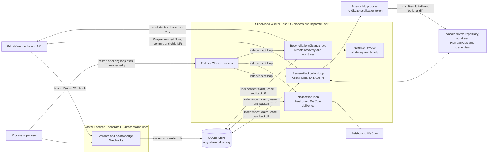

# Runtime and storage specification

## Components



The API acknowledges Webhooks quickly. One supervised Worker OS process runs three independent loops: Review/Publication, Notification and Reconciliation/Cleanup. The third loop also runs the startup/hourly Retention sweep. Each loop isolates per-item errors and uses independent claims/backoff so a stuck notification does not block reviews. Unexpected death of any loop terminates the Worker process; the process supervisor restarts the whole Worker. The Agent remains a child process. Separate Dispatcher/Reconciler OS processes are deferred until operational evidence requires them.

## Review Run and effect lifecycle

A Review Run is unique by `(project_id, mr_iid, sha)` and has no kind discriminator. Its normal lifecycle is:

```text
pending -> running -> succeeded
       ^          \-> failed
       |          \-> cancelled
       +-- deferred Pipeline Gate or Draft check
```

The Store atomically claims eligible work with an opaque token and lease. Expired work is recovered with a dedicated bounded lease-recovery counter; stale tokens cannot heartbeat, finish or mutate a reclaimed item. Transient GitLab, rate-limit and transport failures use capped backoff and a separate failure-attempt counter. Claim count is diagnostic and eligibility deferrals do not consume either failure budget. Configuration, policy, invalid SHA and Agent contract failures are terminal. A head change cancels or supersedes the old key and enqueues the new exact SHA without publishing old effects. All accepted Git SHAs are canonicalized to lowercase before they participate in identity or marker construction.

Note, Auto-fix and notification state is independent from process success. Requested Outputs, the Effective Run Decision and Output Expectations are frozen before effects proceed. User-visible Review Outcome is a projection over those durable expectations and receipts, not a synonym for Agent exit status.

## Fresh SQLite schema

The pre-release implementation performs a hard cutover to a fresh schema; it does not migrate or read legacy ReviewRun kinds, Run-ID markers or Agent-owned publication state. The schema retains at least:

- `review_runs`: ReviewKey, status, claim/failure/lease-recovery counters, lease/token, timestamps and redacted diagnostics;
- `agent_task_snapshots`: immutable per-Run MR presentation and exact GitLab base/start/head diff refs used to render `AgentTaskV1`;
- `requested_outputs`, `effective_run_decisions` and `output_expectations`: immutable decisions used by the Outcome projection;
- `note_publication_requests` and effect receipts: canonical marker, state, attempt, trusted external identity and deletion observation;
- `auto_fix_publication_intents`: immutable generation and nonce, with at most one active generation per ReviewKey;
- `auto_fix_publication_plans`: full canonical Plan, digest, verification evidence and publication state;
- `auto_fix_relations`: parent identity, child identity, observed state, divergence and merge SHA;
- `notification_requests` and delivery outbox: immutable event identity and generation, rendered fields, channel, non-sensitive payload digest, attempts, lease and status;
- `review_run_failures`: failure class, retryability, diagnostic claim number and redacted diagnostic;
- `worktree_cleanup`: workspace path, Run/SHA, attempts, lease and cleanup status;
- `operator_recoveries`: recovery ID, action, exact supplied identities, reason, principal, host, tool version, result and redacted diagnostic.
- `operator_plan_actions`: immutable Plan rearm/abandon action ID, Plan digest, prior/resulting state, write phase, reason, principal, host, tool version, result and redacted rejection diagnostic.

Auto-fix retries reuse the active Intent generation and nonce. Explicit Plan rearm preserves the same immutable payload, digest, generation and nonce: it resets a blocked attempt budget and resumes normal publication only from `preflight`; any Plan that crossed an external-write boundary resumes reconciliation only. New candidate content requires a new Intent rather than rearm. A child MR webhook can reference only an existing local Intent or Relation.

## Immutable payloads and retention

Before any Auto-fix GitLab write, the Store persists the complete immutable Publication Plan, including base SHA, ordered content/actions and modes, branch, marker template, commit message, title, target, readiness and CI behavior. `plan_sha256` is the digest of canonical UTF-8 JSON for those independent inputs, excluding the derived digest value and final rendered marker. The Store freezes that payload, digest and digest-bearing marker together. Publisher, reconciler and explicit recovery parse the same strict typed `PublicationPlanV1` contract instead of maintaining separate identity and digest validators. A pending or uncertain plan remains recoverable without recapturing an Agent workspace.

Operator configuration v4 sets sensitive review, diff, notification and diagnostic retention from 1 to 3650 days, defaulting to 30. The supervised Worker sweeps at startup and hourly. It purges only terminal payloads and retains digests, stable identities, decisions, timestamps, expectations, receipts, Relations and audits. Terminal Agent Task snapshots retain Project/MR identity and exact diff SHAs but purge title and branch presentation. A Note receives a stable retention timestamp on its first terminal publication outcome; successful reconciliation cannot postpone expiry. A purged published Note stops exact-content reconciliation because its original body is intentionally unavailable; its last confirmed identity and state remain historical evidence. Notification presentation, recipients and channels retain only a digest after purge, so recovery-ID replay still rejects changed inputs. Purge never changes the meaning of a completed receipt.

A Publication Plan remains in the active Store after publication or abandonment until the Worker writes canonical JSON to the configured Operator-owned mode-`0700` backup directory, verifies ownership, exact bytes, digest and mode `0600`, fsyncs the file and directory, and records an immutable backup receipt. With no backup directory, Plan payloads are not purged. The digest or GitLab marker alone is deliberately insufficient authority. The recovery CLI consumes retained canonical JSON but never writes it back into the active Store after successful reconstruction.

## Deployment defaults

- SQLite and database polling are the first storage/queue implementation.
- One API process and one supervised Worker process with separate Unix identities are the reference deployment. They share only the SQLite directory; repository, worktrees, Plan backups and Worker credentials are Worker-private.
- One deployment is bound to exactly one GitLab Project.
- The repository is a persistent writable non-shallow checkout or mirror. The Worker obtains a requested SHA through a locked, bounded fetch before creating a detached worktree.
- Agent, verification and publication credentials are distinct Operator-owned inputs; the Agent receives no GitLab publication token.
- Postgres, Redis and separately deployed Worker loops are future implementations behind interfaces.
- SIGTERM stops new Worker claims and waits for in-flight loops; backend and verifier timeouts are individually capped at 1800 seconds and the reference supervisor applies a 3700-second final stop timeout.
